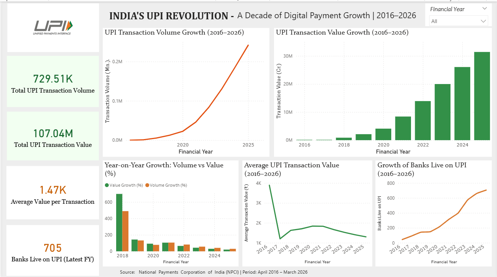
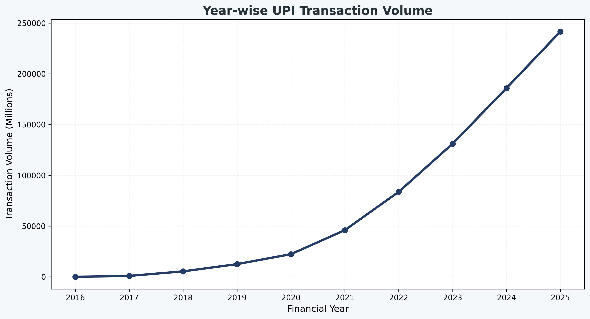
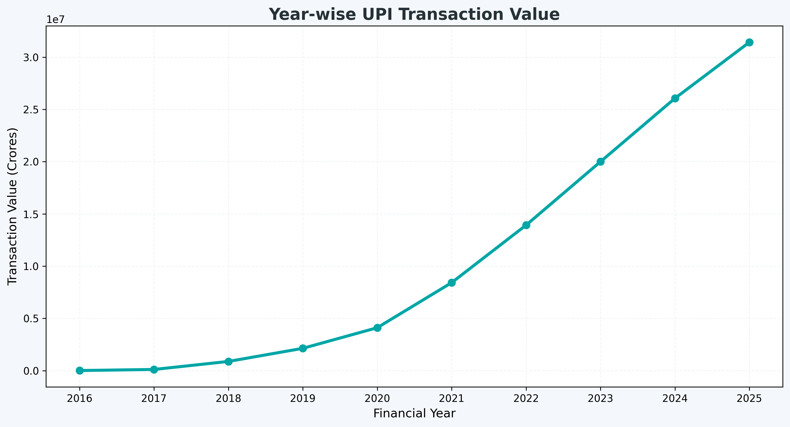
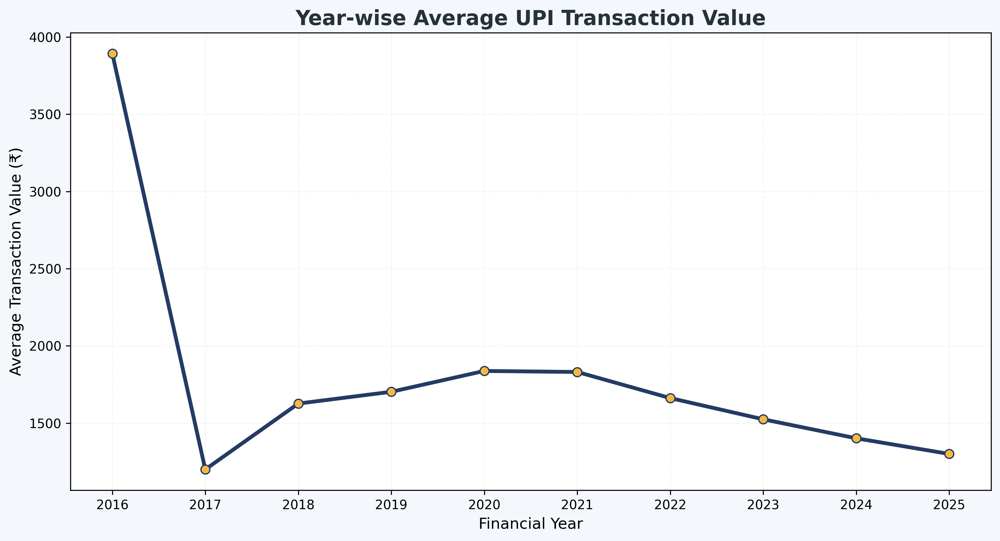
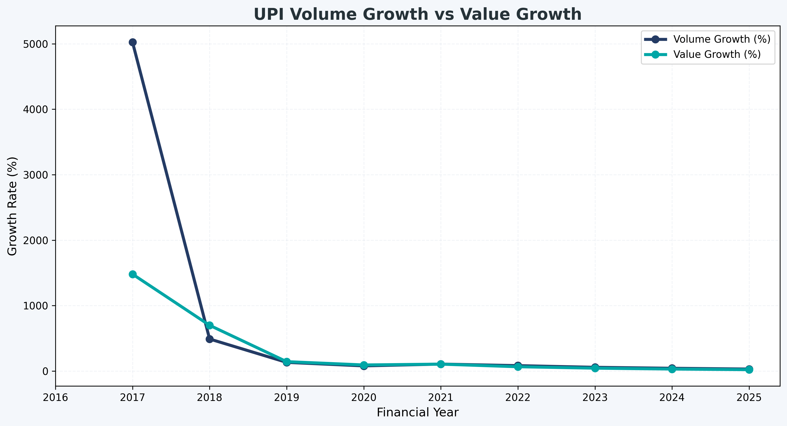
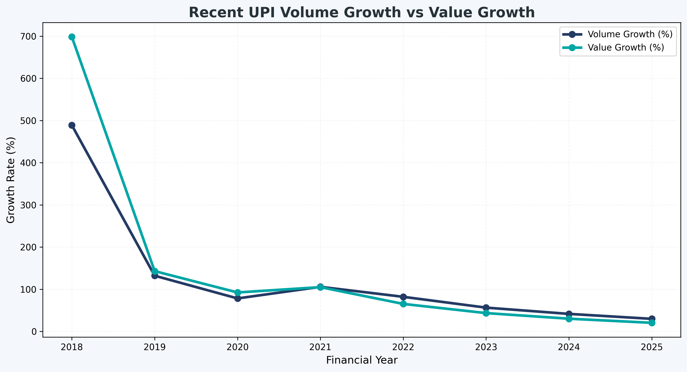
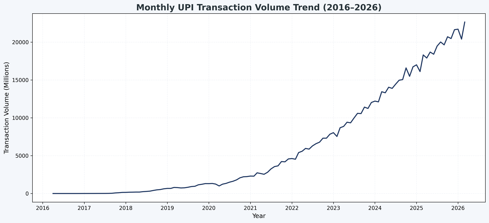
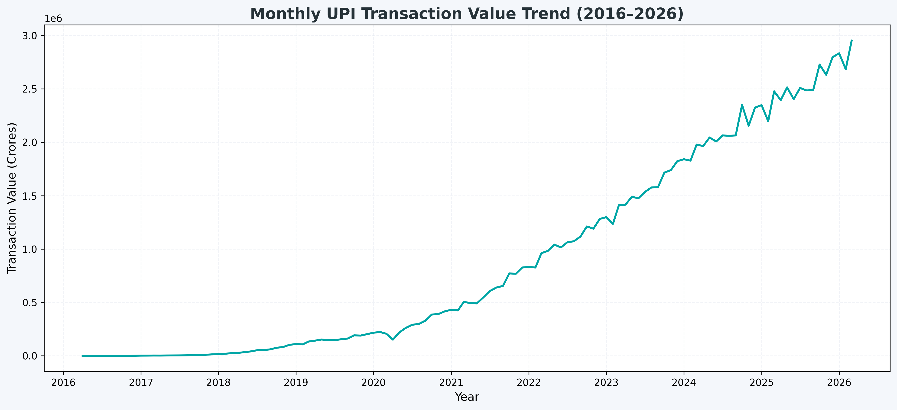

# India's UPI Revolution: A Decade of Digital Payment Growth (2016–2026)

## Project Overview

This project analyzes the growth of India's Unified Payments Interface (UPI) from April 2016 to March 2026 using monthly statistics published by the National Payments Corporation of India (NPCI).

The project explores how UPI transactions have evolved over the last decade in terms of transaction volume, transaction value, participating banks, and average transaction value.

It combines Python-based data analysis, automated data validation, and an interactive Power BI dashboard to transform raw payment statistics into meaningful insights.

## Problem Statement

UPI has become an important part of India's digital payment ecosystem. However, understanding its growth requires examining transaction trends over time, changes in transaction value, and the expansion of participating banks.

This project aims to analyze these changes using historical UPI statistics and present the findings through visualizations and automated reports.

## Project Objectives

- Analyze UPI transaction volume and transaction value over ten financial years.
- Examine the growth of banks participating in UPI.
- Calculate average transaction value.
- Identify year-on-year growth trends.
- Build an interactive Power BI dashboard.
- Develop a Python-based automated data validation and insights system.

## Dataset

**Source:** National Payments Corporation of India (NPCI)

**Period:** April 2016 – March 2026

**Dataset size:** 120 monthly records and 5 columns.

### Dataset Attributes

| Column | Description |
|---|---|
| Month | Monthly transaction period |
| No. of Banks live on UPI | Number of participating banks |
| Volume (In Mn.) | Transaction volume in millions |
| Value (In Cr.) | Transaction value in crores |
| Financial Year | Corresponding financial year |

## Tools and Technologies

- **Python:** Data analysis and automation
- **Pandas:** Data cleaning, manipulation and calculations
- **Matplotlib:** Data visualization
- **Power BI:** Interactive dashboard development
- **Microsoft Excel:** Dataset handling
- **GitHub:** Project version control and portfolio hosting

## Dashboard Preview




## Exploratory Data Analysis (EDA)

### 1. UPI Transaction Volume Growth



### 2. UPI Transaction Value Growth



### 3. Growth of Banks Live on UPI



### 4. Volume vs Value Growth Comparison



### 5. Recent Growth Comparison



### 6. Monthly Transaction Volume



### 7. Monthly Transaction Value



## Key Findings

Based on the analysis of UPI statistics from FY 2016–17 to FY 2025–26:

- UPI transaction volume reached **241,616.88 million transactions** in FY 2025–26.
- Total transaction value reached **₹31,423,249.71 crore** in FY 2025–26.
- The number of banks live on UPI increased to **705** by FY 2025–26.
- Transaction volume recorded **30.00% year-on-year growth** in FY 2025–26.
- Transaction value recorded **20.59% year-on-year growth** in FY 2025–26.
- Average transaction value was approximately **₹1,300.54** in FY 2025–26.
- The analysis also highlights how average transaction value has changed over the decade.

These findings demonstrate the continued expansion of UPI transaction activity and participation across India's digital payment ecosystem.


## How to Run the Project

### Prerequisites

Make sure Python is installed on your system.

Install the required libraries:

```bash
pip install pandas matplotlib openpyxl
```

### 1. Clone the Repository

```bash
git clone YOUR_GITHUB_REPOSITORY_URL
```

### 2. Navigate to the Project Folder

```bash
cd UPI_Growth_Analysis
```

### 3. Run Python Data Analysis

```bash
python upi_analysis.py
```

This script performs data cleaning, analysis, calculations, and visualization.

### 4. Run Automated Data Validation and Insights

```bash
python 
## How to Run the Project

### Prerequisites

Make sure Python is installed on your system.

Install the required libraries:

```bash
pip install pandas matplotlib openpyxl
```

### 1. Clone the Repository

```bash
git clone YOUR_GITHUB_REPOSITORY_URL
```

### 2. Navigate to the Project Folder

```bash
cd UPI_Growth_Analysis
```

### 3. Run Python Data Analysis

```bash
python upi_analysis.py
```

This script performs data cleaning, analysis, calculations, and visualization.

### 4. Run Automated Data Validation and Insights

```bash
python Automation/automated_validation.py
```

This script performs automated data validation, yearly analysis, growth calculations, and insight generation. It also generates validation and insights reports.

### 5. Explore the Power BI Dashboard

Open `UPI_Analysis.pbix` using Microsoft Power BI Desktop.

The interactive dashboard provides visualizations of UPI transaction trends across financial years.

## Project Workflow

### 1. Data Collection and Cleaning
- Collected monthly UPI statistics from NPCI.
- Combined historical datasets.
- Cleaned numerical values and date formats.
- Prepared a consolidated dataset.

### 2. Exploratory Data Analysis
- Analyzed yearly transaction volume and value.
- Calculated average transaction value.
- Examined participating bank growth.
- Calculated year-on-year growth percentages.
- Created visualizations using Matplotlib.

### 3. Power BI Dashboard
Developed an interactive dashboard titled **INDIA'S UPI REVOLUTION**.

The dashboard includes:
- Total transaction volume.
- Total transaction value.
- Banks live on UPI.
- Average transaction value.
- Transaction volume growth.
- Transaction value growth.
- Year-on-year growth comparison.
- Average transaction value trends.
- Growth in participating banks.

### 4. Automated Data Validation and Insights

Developed a Python automation system to perform:

- Required column validation.
- Missing-value detection.
- Duplicate row and month detection.
- Data type validation.
- Negative-value detection.
- Date validation.
- Monthly sequence validation.
- Financial year validation.
- Automated yearly calculations.
- Year-on-year growth calculations.
- Rule-based text insight generation.
- Automatic report and CSV generation.

### Automation Outputs

- `Validation_Report.txt`
- `Insights_Report.txt`
- `Yearly_UPI_Analysis_Automated.csv`

The validation system successfully passed all seven final validation checks on the dataset.

## Key Analysis Areas

- Growth of UPI transaction volume.
- Growth of UPI transaction value.
- Expansion of participating banks.
- Changes in average transaction value.
- Year-on-year growth patterns.

## Project Structure

```text
UPI_Growth_Analysis/
│
├── Raw_Data/
│
├── Graphs/
│
├── Automation/
│   ├── automated_validation.py
│   ├── Validation_Report.txt
│   ├── Insights_Report.txt
│   └── Yearly_UPI_Analysis_Automated.csv
│
├── Cleaned_UPI_Data.csv
├── Yearly_UPI_Analysis.csv
├── upi_analysis.py
├── UPI_Growth_Analysis.pbix
└── README.md
```

## Key Learning Outcomes

- Working with real-world financial datasets.
- Data cleaning and preprocessing using Pandas.
- Exploratory data analysis.
- Statistical calculations and growth analysis.
- Creating meaningful data visualizations.
- Developing interactive Power BI dashboards.
- Building automated data validation and reporting workflows.

## Conclusion

This project provides a decade-long overview of India's UPI growth using real-world monthly payment statistics.

By combining Python, data visualization, automation, and Power BI, the project demonstrates how raw data can be transformed into structured analysis, interactive dashboards, and automatically generated insights.

## Data Source

National Payments Corporation of India (NPCI)

Official Website: https://www.npci.org.in/